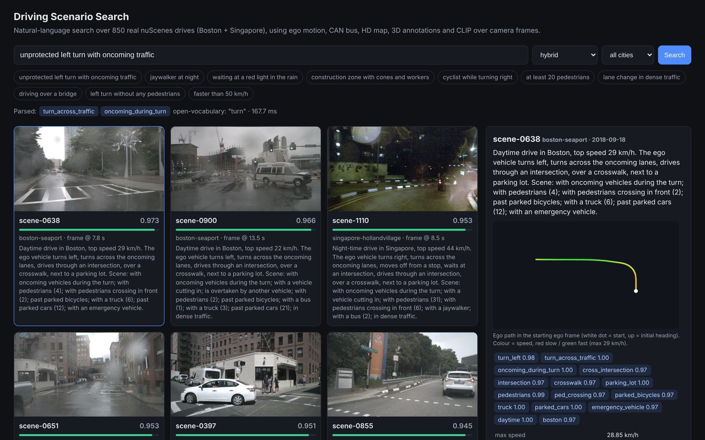

# Driving Scenario Search

Search 850 real-world driving scenes (nuScenes: Boston and Singapore) with plain English, such as *"unprotected left turn at night with pedestrians crossing"*, or with an example scene, then export any result as an OpenSCENARIO 1.2 log-replay for simulation.



<sub>Camera frames: nuScenes (CC BY-NC-SA 4.0). In Singapore, which drives on the left, the same query correctly returns a right turn.</sub>

Autonomous-vehicle teams log far more driving than anyone can watch. **Scenario mining** turns that data into answers for questions like *"show me every cut-in"* or *"find more drives like this failure"*. This is the step that feeds simulation, regression suites and training-data curation. This repository builds a working scenario-mining engine from public data. It also measures how well each search method recovers what human annotators wrote about each scene, using text the index never sees.

**Headline results** (held-out test split: 401 scenes from 13 capture days, 44 fixed queries, all tuning on a separate dev split):

| | mAP | nDCG@10 |
|---|---|---|
| Random | 0.114 | 0.100 |
| CLIP over camera frames only | 0.243 | 0.325 |
| Caption embeddings only | 0.245 | 0.290 |
| Structured tags only (rules) | 0.384 | 0.388 |
| **Hybrid (this repo's default)** | **0.411** | **0.481** |

* The hybrid ranker gets **1.7× the mAP of CLIP-only search** and 3.6× random. Adding CLIP to the structured tags raises nDCG@10 from 0.388 to 0.481.
* **Night retrieval: AP 1.00** without reading a single pixel. Sun elevation is computed from each scene's timestamp and GPS location.
* Ego-maneuver queries are where structured signals matter most. For "turns right", AP is 0.69 for hybrid vs 0.19 for CLIP. For "high speed", it is 0.90 vs 0.33.
* CLIP wins where pixels carry the signal. For "rain", AP is 0.46 vs 0.28 for structured. For "pedestrians crossing", it is 0.49 vs 0.21. That is why the system fuses both.
* Query-by-example: the top-5 neighbours share **1.9×** more human-annotated tags with the query scene than random scenes do (Jaccard 0.296 vs 0.152).
* Latency: p50 16 ms and p95 153 ms per query on a 4-vCPU CPU, including CLIP and MiniLM text encoding.
* Exported `.xosc` files validate against the official ASAM OpenSCENARIO 1.2 XSD, and this is checked in CI.

## What it does

```
nuScenes logs ─┬─ ego pose (20 Hz) + CAN bus ──► maneuvers: turns, stops, waits, lane changes, hard braking, speed
               ├─ HD map expansion (shapely) ──► context: intersection, crosswalk, parking lot, traffic light
               ├─ 3D box annotations ──────────► agents: pedestrians crossing / jaywalking, cyclists, buses,
               │                                 cut-ins, overtakes, oncoming traffic during the turn, construction
               ├─ timestamp + location ────────► sun elevation → day / night (no image needed)
               └─ CAM_FRONT key frames ────────► CLIP ViT-B/16 embeddings (one frame every 2 s)
                                   │
              57-tag ontology with soft scores + generated captions (MiniLM embeddings)
                                   │
   query ──► rule-based parser (tags, negation, "at least 20 pedestrians", "faster than 30 mph")
         ──► hybrid ranker = w · structured tag scores + (1 − w) · (CLIP frames + caption similarity)
         ──► results with evidence: per-term scores, matched time span, best frame, ego trajectory
         ──► query-by-example, OpenSCENARIO 1.2 export (validated against the official ASAM XSD)
```

Example parse:

```text
"unprotected left turn at night with no pedestrians, faster than 30 km/h"
  tags:     turn_across_traffic, night, NOT pedestrians
  filters:  max_speed_kmh > 30
```

`turn_across_traffic` is a left turn in Boston and a **right** turn in Singapore, which drives on the left. The parser handles this through the map location, so the same query works in both cities.

## Evaluation design

* **Held-out ground truth.** Every nuScenes scene has a short description written by a person, for example *"Night, rain, turn left, jaywalker"*. Regexes in [`eval/ground_truth.py`](eval/ground_truth.py) turn these into 33 binary labels. The index and search code never read the descriptions, and [`tests/test_no_leakage.py`](tests/test_no_leakage.py) enforces this.
* **Split by capture day, not by scene.** Weather and lighting are shared within a day, so a scene-level split would leak "rainy afternoon" between halves. All tuning is done on dev: rule thresholds, fusion weights and the learned tag models. Every number below is from test.
* **Fixed queries.** [`eval/queries.json`](eval/queries.json) has 31 single-concept queries with two paraphrases each, plus 16 compositional queries. They were written before any results were inspected. Queries with fewer than 5 positives in test are skipped.
* **Metrics.** For each query: AP over the full test ranking, nDCG@10 and P@10, averaged over paraphrases and then over queries. Query-by-example is scored by the Jaccard overlap of human tags between a scene and its top-5 neighbours.
* **Known limitation.** The descriptions are incomplete, because annotators mention only what stood out to them. A "false positive" is often a real cyclist that nobody wrote down. Absolute precision is therefore underestimated. Comparisons between methods on the same labels are still fair.

## Results

| Method (test split) | mAP | nDCG@10 | P@10 | mAP single | mAP compositional |
|---|---|---|---|---|---|
| random | 0.114 | 0.100 | 0.099 | 0.120 | 0.101 |
| zero-shot caption (MiniLM) | 0.245 | 0.290 | 0.291 | 0.240 | 0.258 |
| zero-shot CLIP (frames) | 0.243 | 0.325 | 0.311 | 0.234 | 0.266 |
| zero-shot open vocabulary (CLIP + caption) | 0.291 | 0.356 | 0.342 | 0.271 | 0.337 |
| zero-shot structured (rules) | 0.384 | 0.388 | 0.393 | 0.362 | 0.438 |
| **zero-shot hybrid** | **0.411** | 0.481 | 0.460 | 0.388 | **0.465** |
| learned structured | 0.404 | 0.500 | 0.477 | 0.385 | 0.451 |
| learned hybrid | **0.414** | **0.514** | **0.493** | **0.395** | 0.457 |

Findings, including the negative ones:

* **Weak supervision barely moves mAP.** "Learned" swaps rule scores for per-tag logistic regressions trained on dev descriptions, using measures plus mean CLIP embeddings. It improves nDCG@10 (0.481 → 0.514) but not mAP (0.411 → 0.414). The hand-built detectors already capture most of what the labels can teach with about 450 training scenes.
* **The day-level split matters.** Rain is concentrated on a few days: 150 rainy scenes in dev, 17 in test. On "rain", the learned model drops to AP 0.13 while zero-shot CLIP gets 0.46. In other words, the model had learned the rainy days, not the rain. A scene-level split would have hidden this.
* **Weak spots:** jaywalkers (0.15), lane changes (0.15), barriers (0.10) and "cross intersection" (0.18). These events are short or ambiguous, and the human labels are sparse and inconsistent ("cross intersection" is mentioned in only some of the scenes that drive through one).

Full per-query tables, query-by-example and latency are in [`results/RESULTS.md`](results/RESULTS.md), generated by `python -m eval.run_eval`. CI checks that the rendered file matches `results/results.json`.

## Quick start

```bash
pip install -e ".[ml,dev]"
bash scripts/download_nuscenes.sh          # metadata, CAN bus, map expansion, CAM_FRONT key frames
python scripts/download_models.py           # CLIP ViT-B/16 + all-MiniLM-L6-v2 (or --from-docker)
python -m scenario_search build             # logs -> measures -> tags -> caption + CLIP index (~30 min CPU)
python -m eval.run_eval                     # tunes on dev, writes results/RESULTS.md
python -m scenario_search serve             # http://127.0.0.1:8000
```

`SKIP_IMAGES=1 bash scripts/download_nuscenes.sh` fetches about 1.6 GB instead of about 46 GB. Structured search, query-by-example and export work without images, but CLIP search does not.

API:

| Endpoint | Purpose |
|---|---|
| `GET /api/search?q=...&mode=hybrid\|structured\|clip\|caption&location=boston` | ranked scenarios with per-term scores, evidence span, best frame |
| `GET /api/scenario/{scene}` | measures, tags, ego trajectory, frames |
| `GET /api/similar/{scene}` | query-by-example |
| `GET /api/export/{scene}.xosc` | OpenSCENARIO 1.2 log replay (ego + up to 60 agents) |
| `GET /health` | readiness |

Docker: `docker build -t scenario-search . && docker run -p 8000:8000 -v $PWD/artifacts:/app/artifacts -v $PWD/models:/app/models scenario-search`

## Repository layout

```
src/scenario_search/
  nuscenes_io.py   raw tables -> compact per-scene logs (no nuscenes-devkit dependency)
  features.py      ego / CAN / map / agent measures + evidence time spans
  hdmap.py         map expansion polygons, STRtree point queries, lane graph
  solar.py         sun elevation from timestamp + location
  ontology.py      57 tags: measure, threshold, phrases
  query.py         NL parser: phrases, negation, numeric filters, residual text
  search.py        hybrid ranker, query-by-example
  learned.py       weakly supervised tag classifiers (dev labels only)
  export_xosc.py   OpenSCENARIO 1.2 export
  api.py, static/  FastAPI service + single-page demo
eval/              ground-truth regexes, fixed queries, end-to-end evaluation
tests/             synthetic map + scenarios (no dataset needed in CI), schema validation, leakage guard
```

## Design notes and trade-offs

* **Why a rule parser and not an LLM?** It runs in about 0.1 ms, is deterministic and is easy to test, and the tag vocabulary is closed. Anything it doesn't recognise goes to CLIP and caption search. An LLM-based parser could slot into `query.parse` without changes elsewhere.
* **Why soft scores?** Thresholds are tuned on dev, but scores stay graded (a logistic ramp), so a 75° turn still ranks above a 40° one, and combining several terms still produces a ranking.
* **Front camera only.** Annotators mostly describe what is visible ahead, and one camera keeps indexing to about 8.5k frames on a CPU. Agent counts include a front-camera-visible variant (within the 70° field of view, at least 40% visible) for the same reason.
* **What is not here:** lidar, radar, 6-camera fusion, learned trajectory embeddings, and OpenDRIVE export (the `.xosc` references a placeholder road network).

## Data and licence

Code: MIT. nuScenes data is © Motional and licensed [CC BY-NC-SA 4.0](https://www.nuscenes.org/terms-of-use). It is downloaded by the script and never committed. Model weights: OpenAI CLIP (MIT) and sentence-transformers all-MiniLM-L6-v2 (Apache 2.0).
